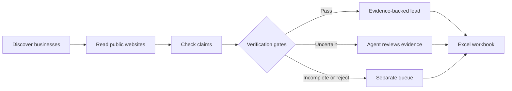

<div align="center">


# Gruffet 🦦

### Find businesses. Verify contacts. Research competitors. Keep the evidence.

**Open-source Python CLI for local business lead discovery, public contact research, and competitor intelligence—built for AI coding agents.**

[](LICENSE)
[](pyproject.toml)
[](#-status-and-limitations)
[](https://github.com/Zqtion/Gruffet/issues)
[](https://github.com/Zqtion/Gruffet/actions/workflows/ci.yml)

**[⚡ Install](#-quick-start) · [🔍 Workflow](#-the-investigation-pipeline) · [📈 Competitor research](#-competitor-research) · [❓ FAQ](#-frequently-asked-questions) · [🤝 Contribute](#-contributing)**

</div>


---

## 🧭 Beyond a list of scraped names

**Gruffet** discovers local businesses, investigates public websites, checks contact claims against available sources, and exports a research workbook with supporting evidence. It also examines competitor sites for publicly visible market signals.

```text
YOUR REQUEST                GRUFFET RESEARCH PIPELINE                  RESULT
Dentists in Leeds    →  Discover → Enrich → Verify → Review    →  Sourced XLSX
Compare rivals       →  Fetch → Extract → Analyse → Report     →  Research workbook
```

> [!IMPORTANT]
> **v0.1 is an early release.** Its `perfect` tier means the current verification rules passed—not that the business is open today, a contact is correct, or the branch address matches. Independently verify records before outreach.

## ✨ Features

| | Capability | What it does |
|:--:|---|---|
| 🔎 | **Local business discovery** | Search business categories near a location, using OpenStreetMap. |
| 🌐 | **Website enrichment** | Extract published contact information, links, and site signals. |
| 🛡️ | **Evidence-backed verification** | Check site availability, identity matches, closure signals, and corroboration. |
| 🧠 | **Coding-agent review** | Small evidence cards let an agent assess ambiguous records. |
| 📈 | **Competitor intelligence** | Review site positioning, visible pricing, technologies, and content clues. |
| 📊 | **Structured Excel export** | Separate lead tiers, gate results, sources, and competitor findings. |
| 🔑 | **Keyless default pipeline** | No separate paid scraping or LLM API key; use your existing coding agent. |

## ⚡ Quick start

**Requires Python 3.10+.** Install using [uv](https://docs.astral.sh/uv/) or pip.

```bash
uv tool install git+https://github.com/Zqtion/Gruffet.git
gruffet doctor
gruffet run "dentist" --near "Leeds, United Kingdom" --limit 40
```

Your output: **`gruffet-out/leads.xlsx`**, including research, evidence, and records needing review.

<details>
<summary><strong>Other installation methods</strong></summary>

```bash
pip install git+https://github.com/Zqtion/Gruffet.git

# Contributor setup
git clone https://github.com/Zqtion/Gruffet.git
cd Gruffet
uv venv
uv pip install -e ".[dev]"
pytest
```

Optional browser rendering for JavaScript-heavy sites: `pip install -e ".[browser]" && crawl4ai-setup` from a clone.
</details>

## 🔍 The investigation pipeline



**Four current checks:** `website_alive`, `identity_match`, `not_closed`, and `contact_corroborated`.

Run each stage yourself:

```bash
gruffet discover "travel agency" --near "Dhaka, Bangladesh" --radius 4000
gruffet enrich
gruffet verify
gruffet missing
gruffet review --budget 1500
gruffet export
```

**Verification is not sales qualification.** A contact may be corroborated but still be a poor prospect. Gruffet does not claim that a found email or phone number is current, consented for outreach, or linked to a decision-maker.

## 🤖 Built for coding agents

- **Claude Code:** install the CLI and copy [`skills/gruffet`](skills/gruffet) into your project's `.claude/skills/gruffet/`.
- **Codex / Cursor:** use the same CLI with [`AGENTS.md`](AGENTS.md). These integrations have not been fully field-tested.
- **Other agents:** any agent that can run shell commands can potentially use the CLI; support is not guaranteed.

> “Use Gruffet to research dentists in Leeds, check published contact information, and explain the evidence behind each result.”

## 📈 Competitor research

```bash
gruffet compete add https://rival-one.com https://rival-two.com
gruffet compete run
gruffet compete report
gruffet note "Comparison" "@analysis.md"
gruffet export
```

Collect visible positioning, pricing clues, site technology signals, and content clues. Pricing classifications and website “weak spots” are **heuristics**, not independently confirmed judgments.

## 🎬 Watch Gruffet in action

**[▶ Watch the 56-second Gruffet introduction](https://github.com/Zqtion/Gruffet/releases/download/v0.1.0/Gruffet_GitHub_Under_10MB.mp4)** · [v0.1.0 early preview release](https://github.com/Zqtion/Gruffet/releases/tag/v0.1.0)

*Promotional explainer showing an illustrative research workflow; not an independently validated live performance demo.*

## ❓ Frequently asked questions

**What is Gruffet?** Gruffet is an open-source Python command-line tool (CLI) for discovering local businesses, researching publicly available business contact information, checking evidence, and exporting structured lead-research workbooks. It includes an early competitor website research module.

**Is Gruffet free?** Yes. The code is MIT-licensed, and the default workflow does not require a paid data-provider key. Internet connectivity is required to query data sources and business websites; your own infrastructure or third-party usage may still have costs.

**Is Gruffet an AI agent or a scraper?** The v0.1 CLI performs deterministic discovery, extraction, and rule-based checks. An external coding agent can review ambiguous evidence. It is **not** an autonomous sales agent and does **not** send outreach.

**Does it use Google Maps?** The default discovery source is OpenStreetMap. There is an experimental opt-in Google Maps browser plugin; scraping Google Maps may violate Google's terms. This route is not recommended for hosted or commercial use.

**Can I use Gruffet with Claude Code, Codex, or Cursor?** The CLI can be run from shell-capable coding agents. Claude Code has project skill instructions; the other integrations have not been fully field-tested. See [agent setup](#-built-for-coding-agents).

**Does Gruffet have Agent Reach, autonomous deep research, or MCP support?** Not in the v0.1.0 release. The Agent Reach / Crawl4AI research work is experimental in [draft PR #2](https://github.com/Zqtion/Gruffet/pull/2). MCP, scheduling, and CRM integrations are future work.

**How accurate are leads?** Accuracy depends on source coverage, website content, and the check results. A passing check is not proof that a company is active, a location is correct, or a contact is reachable. Independently validate important records before use.

Read the [full FAQ](docs/FAQ.md) for source, privacy, and setup details.

## 🧪 Status and limitations

**Early v0.1:** Lead discovery, website checks, agent review, Excel export, and a basic competitor module exist. The repository contains **41 unit tests**. This does not establish production reliability.

| Available today | Important caveat |
|---|---|
| OpenStreetMap discovery | Coverage and contact fields vary by region. |
| Website and contact checks | **Branch addresses are not cross-checked.** |
| Corroboration tiers | Agreement between sources does not guarantee current accuracy. |
| Coding-agent review | Primarily tested with Claude Code. |
| Competitor comparisons | Some assessments rely on heuristics. |

**Google Maps notice:** An experimental opt-in browser plugin is included. Scraping Google Maps conflicts with Google's terms; don't use this route in a hosted or paid product. Use properly licensed data instead.

**Responsible use:** Respect robots.txt, site terms, data licenses (including OpenStreetMap attribution/ODbL), applicable privacy and marketing laws, and third-party image rights. A public phone or email is not consent to unsolicited marketing.

## 🗺️ What's next

- [ ] Better branch and address verification
- [ ] Additional appropriately licensed discovery sources
- [ ] More extensive reliability benchmarks
- [ ] Competitor comparisons across time
- [ ] MCP support, scheduling, and CRM integrations (not implemented)

## 🤝 Contributing

Open a [feedback issue](https://github.com/Zqtion/Gruffet/issues/new/choose) when a search misses businesses, verification fails, or setup breaks. Include the operating system, exact command, and redacted example. Read [CONTRIBUTING.md](CONTRIBUTING.md) for development instructions.

**[MIT License](LICENSE)** · **[Third-party credits and data notices](THIRD_PARTY.md)** · **[Project FAQ](docs/FAQ.md)** · Made by [Zqtion](https://www.zqtion.com/)

<div align="center"><sub>For builders who prefer evidence over scraped guesses.</sub></div>
